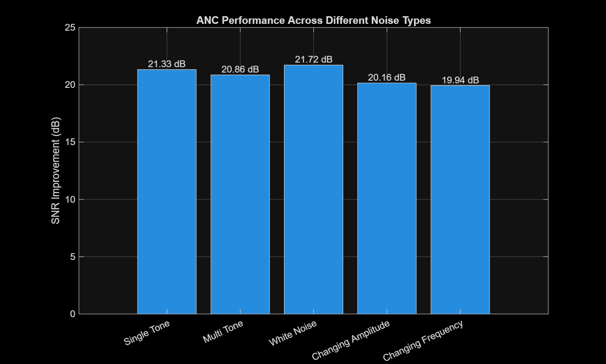
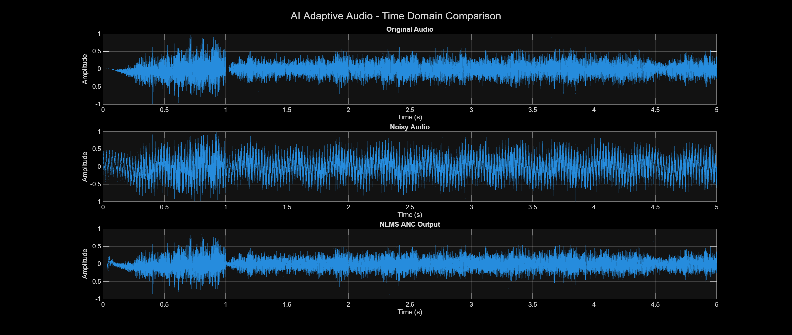
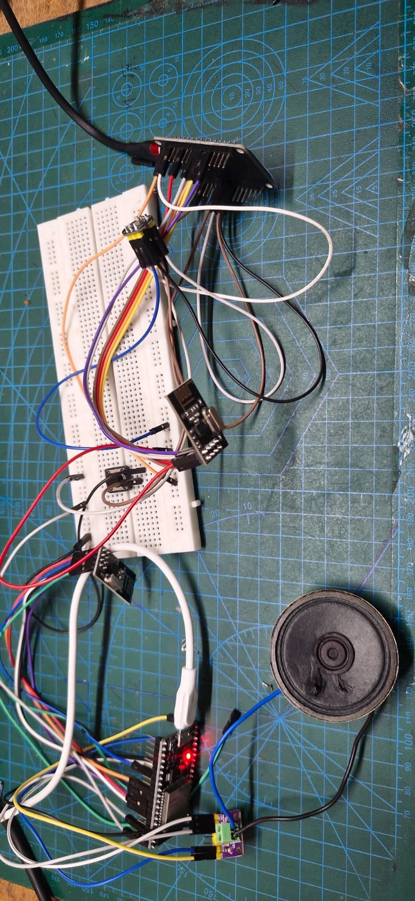

# Real-Time Adaptive Noise Cancellation and Wireless Audio System

## 📌 Project Overview

This project explores adaptive noise cancellation using the Normalized Least Mean Squares (NLMS) algorithm and wireless audio transmission using ESP32 microcontrollers.

The project combines MATLAB-based adaptive noise cancellation simulation with a hardware-based wireless audio communication system. The MATLAB implementation demonstrates noise reduction using an adaptive filter, while the hardware setup captures audio using an INMP441 digital microphone and transmits audio samples wirelessly using nRF24L01 modules.

The long-term objective is to integrate adaptive noise cancellation into the wireless audio system for improved audio quality in noisy environments.

## 🎯 Objectives

- Implement adaptive noise cancellation using the NLMS algorithm in MATLAB.
- Generate test signals and simulate noise contamination.
- Evaluate noise cancellation performance using Signal-to-Noise Ratio (SNR).
- Implement wireless audio transmission using two ESP32 development boards.
- Capture audio using an INMP441 I2S digital microphone.
- Transmit audio data through nRF24L01 wireless modules.
- Reproduce received audio through a MAX98357A I2S audio amplifier.
- Explore the future integration of adaptive noise cancellation into the real-time audio pipeline.

## 🧰 Hardware Components

| Component | Purpose |
|---|---|
| ESP32 DevKit V1 × 2 | Audio transmitter and receiver |
| INMP441 microphone | Digital audio acquisition |
| nRF24L01 modules × 2 | Wireless audio communication |
| MAX98357A amplifier | I2S audio output |
| Speaker | Audio playback |
| Breadboard and jumper wires | Circuit connections |
| USB power supplies | Power and programming |

## 💻 Software and Tools

- MATLAB
- Arduino IDE
- ESP32 Arduino Core
- RF24 library
- I2S audio interface
- C/C++ for embedded development

## 🧠 System Architecture

### 1. MATLAB Adaptive Noise Cancellation

The MATLAB implementation generates a clean test signal, a reference noise signal, and a noise-corrupted input signal. An acoustic-path model is used to represent the reference noise reaching the measured signal.

The NLMS algorithm adaptively estimates the unwanted noise component and subtracts it from the noisy input.

**Processing flow:**

Clean Signal + Noise → Noisy Input → NLMS Adaptive Filter → Enhanced Output

The MATLAB implementation also evaluates different filter lengths and step sizes to investigate their effects on noise cancellation performance.

### 2. Wireless Audio Hardware

The hardware system uses two ESP32 boards.

**Transmitter:**

INMP441 Microphone → ESP32 → nRF24L01 Transmitter

**Receiver:**

nRF24L01 Receiver → ESP32 → MAX98357A Amplifier → Speaker

The transmitter samples microphone audio at 8 kHz and sends audio packets containing sequence information and audio samples. The receiver reconstructs the audio stream and outputs it through the I2S amplifier.

### 3. Planned Integration

The next development stage is to integrate adaptive noise reduction into the live audio path.

A reference-based NLMS implementation requires a suitable reference signal correlated with the unwanted noise. The current single-microphone hardware setup does not yet provide a dedicated reference-noise input, so the MATLAB simulation and the wireless audio hardware are currently separate working parts of the project.

## 📊 MATLAB Results

The following section contains the results obtained from the MATLAB simulation.

### 1. Input and Output Waveforms

This figure can show the noisy input signal and the enhanced output after NLMS filtering.

### 2. SNR Improvement

This figure can show the measured SNR before and after adaptive noise cancellation.

### 3. NLMS Parameter Optimization

The optimization script compares multiple filter lengths and step sizes and visualizes their SNR improvement results.

*Replace the example image paths above with the actual filenames of your MATLAB screenshots. Do not report numerical SNR improvements unless they have been measured from your simulation.*

## 🔌 Hardware Implementation

The wireless audio hardware has been implemented using ESP32 boards, an INMP441 microphone, nRF24L01 wireless modules, and a MAX98357A amplifier.

The transmitter acquires microphone samples and sends them in packets. The receiver processes the packets and produces audio output through the speaker.

### Hardware Setup

## 📚 Learning Outcomes

This project provides practical experience in:

- Adaptive signal processing
- NLMS algorithm implementation
- SNR measurement and performance evaluation
- I2S digital audio acquisition and playback
- ESP32 embedded programming
- nRF24L01 wireless communication
- Real-time audio system design
- MATLAB simulation and hardware integration

## 👨‍💻 Conclusion

The project establishes a MATLAB simulation for adaptive noise cancellation and a working ESP32-based wireless audio system. These implementations provide a foundation for further development toward real-time adaptive noise reduction in a wireless audio application.
